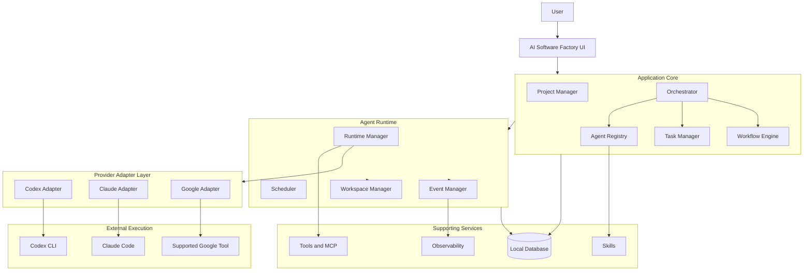
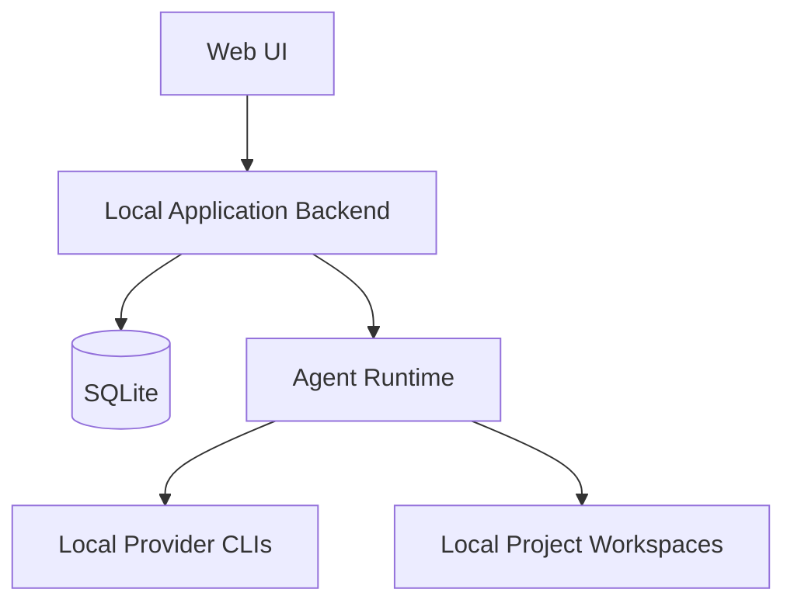

```yaml
document_id: DOC-14
title: System Architecture
version: 1.0
status: draft
created_at: 2026-11-05
updated_at: 2026-11-05
owner: Project Team
related_documents:
  - DOC-05 Component Architecture
  - DOC-06 Domain Model
  - DOC-08 State Machine & Event Architecture
  - ADR-0001 First Provider — Claude Code
  - ADR-0002 Claude Code Integration via CLI Subprocess
  - ADR-0003 Product Positioning — Template-based AI Software Factory
  - ADR-0004 Own Agent Runtime vs Building on Orca
  - ADR-0005 Application Form — Local Web App
```

# System Architecture

## 1. Architecture Goals

The architecture of AI Software Factory must satisfy the following goals:

1. Provider independence.
2. Agent role independence from provider and model.
3. Local-first execution.
4. Reliable task orchestration.
5. Observable agent execution.
6. Extensible tools and skills.
7. Safe workspace isolation.
8. Future support for remote and distributed execution.

The architecture should start simple and evolve without introducing unnecessary infrastructure in the MVP.

## 2. High-level Architecture



This is a conceptual architecture. The initial implementation may combine several components into a single application process.

## 3. Architecture Layers

### 3.1 Presentation Layer

Responsible for the user interface.

Main areas:

- Command Center.
- Project Management.
- Task Management.
- Agent Management.
- Agent Office.
- Workflow Management.
- Observability.
- Settings.

The UI communicates with the application backend through a defined API and receives real-time updates through an event channel.

The UI must not directly launch provider processes or control task execution.

### 3.2 Application Core

Contains the main business logic.

#### Project Manager

Manages projects, repositories and project context.

#### Task Manager

Manages task definitions, dependencies, statuses and execution history.

#### Orchestrator

The central decision-making component.

Responsibilities:

- Understand user requests.
- Analyze project context.
- Create execution plans.
- Decompose work into tasks.
- Select suitable agent profiles.
- Delegate tasks.
- Aggregate results.
- Handle replanning and recovery.

The Orchestrator should make decisions using structured task and agent contracts rather than relying only on free-form conversations.

#### Agent Registry

Stores available Agent Profiles.

It answers questions such as:

- Which agent roles exist?
- Which skills does each role have?
- Which tools can each role use?
- Which providers are supported?
- Which models are available?

#### Workflow Engine

Manages predefined execution workflows and their transitions.

For example:

`Analysis → Architecture → Implementation → Review → Testing → Delivery`

### 3.3 Agent Runtime Layer

Responsible for creating, managing and monitoring actual agent executions.

#### Runtime Manager

- Creates agent instances.
- Starts and stops execution processes.
- Tracks process lifecycle.
- Handles timeouts.
- Collects output.
- Handles termination and cleanup.

#### Scheduler

- Selects tasks that are ready to execute.
- Checks dependencies.
- Enforces concurrency limits.
- Applies priority rules.
- Prevents unsafe simultaneous execution.

#### Workspace Manager

Provides an isolated working environment for each execution.

Possible strategies:

- Dedicated working directory.
- Git branch.
- Git worktree.
- Temporary workspace.

The system should avoid allowing multiple agents to modify the same files simultaneously without coordination.

#### Event Manager

Publishes lifecycle events such as:

- `task.created`
- `task.started`
- `task.completed`
- `task.failed`
- `agent.instance.started`
- `agent.instance.waiting`
- `agent.instance.completed`
- `agent.instance.failed`
- `approval.requested`

Events provide a shared source of updates for the UI, task system and observability module.

### 3.4 Provider Adapter Layer

The adapter layer isolates provider-specific behavior from the core system.

Potential adapters:

- Codex Adapter.
- Claude Code Adapter.
- Google Adapter.
- Future provider adapters.

Each adapter translates normalized platform requests into provider-specific execution commands and translates results back into the platform's normalized format.

Example conceptual interface:

```typescript
interface ProviderAdapter {
  getCapabilities(): Promise<ProviderCapabilities>;

  startExecution(
    request: AgentExecutionRequest
  ): Promise<ExecutionHandle>;

  sendInput(
    executionId: string,
    input: string
  ): Promise<void>;

  terminate(
    executionId: string
  ): Promise<void>;

  getStatus(
    executionId: string
  ): Promise<ExecutionStatus>;
}
```

This is a conceptual contract. The final interface must account for differences between CLI processes, SDKs and remote APIs.

Important:

- Do not assume every provider supports the same capabilities.
- Do not assume every CLI supports the same interaction protocol.
- Do not assume native subagent capabilities are portable across providers.
- Keep provider-specific implementation details inside adapters.

### 3.5 External Execution Layer

This layer contains the actual provider tools and processes.

For the initial local-first version:

- Official Codex CLI.
- Official Claude Code CLI.
- Other supported local tools.

The platform launches these tools through their supported interfaces.

Provider authentication remains managed by the official tools.

The platform should not collect subscription passwords, extract private OAuth tokens or impersonate a provider's official client.

## 4. Core Domain Concepts

The following concepts should remain distinct.

### Provider

The external AI service or execution environment.

Examples:

- OpenAI.
- Anthropic.
- Google.

### Model

The specific model selected from a provider.

### Agent Profile

A reusable definition of an agent's role.

Example:

```yaml
name: frontend-agent
role: frontend_developer
description: Implements frontend features.

provider_preference: claude-code
model_preference: default

skills:
  - frontend-development
  - code-review

tools:
  - filesystem
  - terminal
  - git
```

The actual provider and model should be configurable at runtime.

### Agent Instance

A live execution of an Agent Profile.

An instance belongs to a task or execution context and has its own lifecycle.

### Task

A unit of work that must be completed.

A task may have one or more execution attempts.

### Execution

A concrete runtime operation performed by an agent instance.

It includes:

- Provider.
- Model, when available.
- Process or execution identifier.
- Start and end time.
- Status.
- Logs.
- Artifacts.
- Usage information.

### Skill

Reusable instructions and procedures that an agent can use.

### Tool

An executable capability exposed to an agent.

A tool may be built in, provided by an external integration or exposed through MCP.

## 5. Orchestration Model

The Orchestrator is responsible for coordinating work, but it should not perform every task itself.

A typical flow:

```
flowchart TD
    A[User Requirement] --> B[Analyze Request]
    B --> C[Analyze Project Context]
    C --> D[Create Execution Plan]
    D --> E{User Approval Required?}
    E -->|Yes| F[Wait for Approval]
    F --> G[Schedule Tasks]
    E -->|No| G
    G --> H[Select Agent Profiles]
    H --> I[Create Agent Instances]
    I --> J[Execute Tasks]
    J --> K[Collect Results]
    K --> L{Verification Passed?}
    L -->|No| M[Create Fix or Retry Tasks]
    M --> G
    L -->|Yes| N[Aggregate Results]
    N --> O[Deliver to User]
```

The Orchestrator may use different providers for different roles.

Example:

- Codex: Orchestrator.
- Claude Code: Architect.
- Codex: Backend Developer.
- Claude Code: Code Reviewer.

This is an example configuration, not a hard-coded assignment.

## 6. Native Subagents vs Cross-provider Delegation

These are different execution mechanisms.

### Native Subagents

A provider's own runtime creates and coordinates its internal subagents.

Advantages:

- Provider-native coordination.
- Potentially simpler execution.
- May have built-in context and tool handling.

Limitations:

- Capabilities depend on that provider.
- Behavior may not be portable.
- Other providers may not participate directly.

### Cross-provider Delegation

AI Software Factory creates an execution request and launches another provider through its adapter.

Example:

Codex Orchestrator → Factory Runtime → Claude Code Adapter → Claude Code Process.

Advantages:

- Multiple providers can collaborate.
- Centralized task tracking.
- Provider choice can vary by agent profile.

Limitations:

- The factory must manage context transfer.
- Execution protocols differ.
- Process lifecycle and errors must be handled.
- Usage and cost reporting may differ.

The platform should support cross-provider delegation through its own runtime abstraction.

## 7. State and Event Architecture

The system must have one authoritative representation of task and agent execution state.

For example:

- Task Management reads task state.
- Agent Management reads agent profiles and instances.
- Agent Office reads agent instance state and events.
- Command Center reads aggregated project and runtime state.
- Observability reads execution events and logs.

These modules must not maintain conflicting copies of the same operational status.

### State vs Events

State answers:

"What is happening now?"

Events answer:

"What happened, and in what order?"

The initial system can persist current state and event history in a local database.

A full event-sourcing architecture is not required for the MVP.

## 8. Local-first Deployment

Initial deployment:



The application runs locally, while provider tools may communicate with their respective cloud services.

Local-first does not mean every model runs locally.

### Initial Infrastructure

- Local application backend.
- Local database.
- Local filesystem.
- Installed provider CLI tools.
- Local event and log storage.

Avoid introducing distributed infrastructure before there is a demonstrated need.

## 9. Security and Execution Safety

Agent execution is powerful and must be controlled.

Important requirements:

- Explicit tool permissions.
- Workspace boundaries.
- Safe handling of environment variables and secrets.
- Approval for sensitive operations.
- Clear process termination.
- Execution timeouts.
- Audit history.
- Protection against unintended repository changes.
- No automatic exposure of credentials to agents that do not need them.

The platform should distinguish between:

- Read-only operations.
- File modification.
- Terminal execution.
- Network access.
- Git operations.
- Destructive operations.

A user's approval should be required for configured high-risk actions.

## 10. Future Remote Execution

The architecture should not assume that all agents will always run on the same machine.

A future version may introduce:

- Remote worker nodes.
- Server-hosted orchestration.
- Distributed execution.
- Shared project workspaces.
- Team collaboration.

The Runtime Manager should own the execution abstraction so that local and remote workers can eventually implement the same execution contract.

This is a future extension, not an MVP requirement.

## 11. Architecture Decisions


| Decision                | Initial direction                    |
| ----------------------- | ------------------------------------ |
| Product positioning     | AI Software Factory (ADR-0003)       |
| Deployment              | Local-first                          |
| Application form        | Local web app (ADR-0005)             |
| Provider integration    | Adapter-based                        |
| Agent definition        | Provider-independent                 |
| Execution               | Official local CLI tools first       |
| First provider          | Claude Code (ADR-0001)               |
| Claude Code integration | CLI subprocess (ADR-0002)            |
| Orchestration           | Central Orchestrator                 |
| Task state              | Central Task Manager                 |
| Runtime state           | Runtime Manager                      |
| UI updates              | Event-driven                         |
| Database                | Local database initially             |
| Workspace isolation     | Separate workspaces or Git worktrees |
| Workflow                | Predefined workflows initially       |
| Runtime ownership       | Own runtime, no Orca (ADR-0004)      |
| Remote workers          | Future capability                    |


## 12. Key Architectural Rule

The most important rule:

> The runtime is the source of truth for execution. The UI visualizes it; it does not simulate it.

This keeps the system consistent as more agents, providers and execution modes are added.
